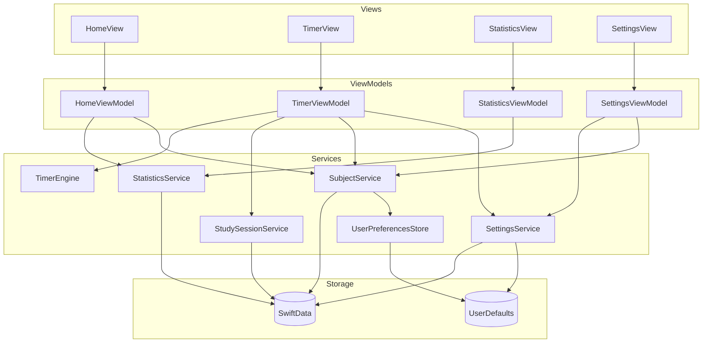

# MyPomodoro SwiftUI + MVVM 아키텍처 설계

> 기준: [specs/](./specs/README.md) · [project.md](./project.md)  
> 플랫폼: iOS 18+ · UI: SwiftUI · 저장소: SwiftData

---

## 설계 원칙

| 원칙 | 설명 |
|------|------|
| 단방향 데이터 흐름 | `View → ViewModel → Service → Storage` |
| View는 표시만 | 비즈니스 로직·저장은 ViewModel·Service에 위임 |
| Service는 재사용 | 타이머·집계·CRUD를 화면별 ViewModel이 공유 |
| SwiftData는 Model 계층 | `@Model` 엔티티 + Service가 `ModelContext` 접근 |
| 테스트 용이성 | Service는 Protocol 기반, ViewModel은 Protocol 주입 |



---

## 폴더 구조

```
MyPomodoro/
├── App/
│   ├── MyPomodoroApp.swift              # @main, ModelContainer 설정
│   └── AppDependencies.swift            # Service 인스턴스 조립 · Environment 주입
│
├── Views/
│   ├── Root/
│   │   └── MainTabView.swift            # TabView (Home · Timer · Statistics · Settings)
│   │
│   ├── Home/
│   │   ├── HomeView.swift
│   │   └── Components/
│   │       ├── TodaySummaryCard.swift   # 오늘 시간 · 세션 수 · 달성률
│   │       └── QuickStartSection.swift  # 마지막 과목 + 타이머 시작
│   │
│   ├── Timer/
│   │   ├── TimerView.swift
│   │   └── Components/
│   │       ├── TimerDisplayView.swift   # 모드 · 남은 시간
│   │       ├── TimerControlBar.swift    # 시작 · 일시정지 · 중단
│   │       └── SubjectPickerView.swift  # 과목 선택 피커
│   │
│   ├── Statistics/
│   │   ├── StatisticsView.swift
│   │   └── Components/
│   │       ├── PeriodSummaryView.swift  # 일별 · 주별 시간
│   │       ├── SubjectDistributionChart.swift
│   │       └── StatisticsEmptyState.swift
│   │
│   ├── Settings/
│   │   ├── SettingsView.swift
│   │   └── Components/
│   │       ├── TimerDurationSection.swift
│   │       ├── DailyGoalSection.swift
│   │       ├── SubjectManagementSection.swift
│   │       └── SubjectEditSheet.swift   # 추가 · 수정
│   │
│   └── Common/
│       ├── EmptyStateView.swift
│       └── ToastView.swift              # 저장 실패 등
│
├── ViewModels/
│   ├── HomeViewModel.swift
│   ├── TimerViewModel.swift
│   ├── StatisticsViewModel.swift
│   └── SettingsViewModel.swift
│
├── Models/
│   ├── SwiftData/
│   │   ├── Subject.swift
│   │   ├── StudySession.swift
│   │   └── DailyGoal.swift
│   ├── Enums/
│   │   ├── TimerMode.swift              # focus · break
│   │   ├── TimerState.swift             # idle · running · paused
│   │   └── DateRange.swift              # today · thisWeek
│   └── Presentation/
│       ├── TodaySummary.swift           # Home 표시용 (비영속)
│       ├── StatisticsSummary.swift
│       └── SubjectDistributionItem.swift
│
├── Services/
│   ├── Protocols/
│   │   ├── TimerEngineProtocol.swift
│   │   ├── StudySessionServiceProtocol.swift
│   │   ├── SubjectServiceProtocol.swift
│   │   ├── StatisticsServiceProtocol.swift
│   │   └── SettingsServiceProtocol.swift
│   ├── TimerEngine.swift
│   ├── StudySessionService.swift
│   ├── SubjectService.swift
│   ├── StatisticsService.swift
│   ├── SettingsService.swift
│   └── UserPreferencesStore.swift
│
└── Utilities/
    ├── Extensions/
    │   ├── Date+Calendar.swift          # 일·주 범위 계산
    │   └── TimeInterval+Formatting.swift
    └── Constants/
        └── AppConstants.swift           # 기본값 (25분, 5분, 120분)
```

---

## View

화면 단위 View와 재사용 컴포넌트. `@StateObject` / `@Bindable`로 ViewModel을 바인딩한다.

| View | 역할 | 바인딩 ViewModel | 주요 UI 상태 |
|------|------|------------------|--------------|
| `MainTabView` | 4탭 네비게이션, 탭 전환 | `selectedTab: Binding<AppTab>` | Home → Timer 빠른 시작 시 탭 전환 |
| `HomeView` | 오늘 요약 · 빠른 시작 | `HomeViewModel` | `todaySummary`, `lastSubject`, empty state |
| `TimerView` | Pomodoro 타이머 | `TimerViewModel` | `displayTime`, `mode`, `state`, `selectedSubject` |
| `StatisticsView` | 통계 차트 | `StatisticsViewModel` | `dateRange`, `summary`, `distribution` |
| `SettingsView` | 설정 · 과목 관리 | `SettingsViewModel` | durations, goal, subjects, sheets |

### View 책임 경계

- **포함**: 레이아웃, 애니메이션, 사용자 제스처 → ViewModel 메서드 호출
- **미포함**: SwiftData 쿼리, 타이머 tick 로직, 집계 계산, 저장 검증

### 화면별 specs 매핑

| specs | View |
|-------|------|
| [focus-timer](./specs/focus-timer.md) | `TimerView` + `TimerDisplayView` + `TimerControlBar` |
| [subject-selection](./specs/subject-selection.md) | `SubjectPickerView`, `SubjectManagementSection`, `SubjectEditSheet` |
| [study-session-storage](./specs/study-session-storage.md) | View 없음 — `TimerViewModel` 완료 시 Service 호출 |
| [statistics](./specs/statistics.md) | `StatisticsView` + 차트 컴포넌트 |
| [home](./specs/home.md) | `HomeView` |
| [settings](./specs/settings.md) | `SettingsView` |

---

## ViewModel

`@Observable`(iOS 17+) 또는 `ObservableObject` 기반. View에 표시할 상태와 사용자 액션을 중개한다.

### HomeViewModel

| 항목 | 내용 |
|------|------|
| **의존성** | `StatisticsService`, `SubjectService` |
| **Published 상태** | `todaySummary: TodaySummary`, `lastSubject: Subject?`, `isLoading`, `errorMessage` |
| **액션** | `load()`, `requestStartTimer()` → 탭 전환 콜백 |

```swift
// 책임 요약
func load() async
func requestStartTimer(onNavigate: (AppTab) -> Void)
```

### TimerViewModel

| 항목 | 내용 |
|------|------|
| **의존성** | `TimerEngine`, `StudySessionService`, `SubjectService`, `SettingsService` |
| **Published 상태** | `mode`, `state`, `remainingSeconds`, `selectedSubject`, `subjects`, `canStart`, `alertMessage` |
| **액션** | `start()`, `pause()`, `resume()`, `stop()`, `selectSubject(_:)`, `onScenePhaseChange(_:)` |

**핵심 흐름**

1. `start()` — 과목·시간 유효성 검사 → `TimerEngine.start(mode: .focus)`
2. 집중 완료 — `StudySessionService.saveCompleted(...)` → `mode = .break` 자동 전환
3. `stop()` — 집중 중단 시 저장 안 함 (specs AC-5)
4. 백그라운드 복귀 — `TimerEngine.syncRemainingTime(from: sessionStartAt)`

### StatisticsViewModel

| 항목 | 내용 |
|------|------|
| **의존성** | `StatisticsService`, `SettingsService` |
| **Published 상태** | `dateRange`, `dailyMinutes`, `weeklyMinutes`, `distribution: [SubjectDistributionItem]`, `isEmpty` |
| **액션** | `load()`, `setDateRange(_:)` |

### SettingsViewModel

| 항목 | 내용 |
|------|------|
| **의존성** | `SettingsService`, `SubjectService` |
| **Published 상태** | `focusMinutes`, `breakMinutes`, `dailyGoalMinutes`, `subjects`, `editingSubject`, `validationError` |
| **액션** | `updateFocusMinutes(_:)`, `updateBreakMinutes(_:)`, `updateDailyGoal(_:)`, `addSubject`, `updateSubject`, `deleteSubject` |

### ViewModel 간 공유

| 공유 대상 | 방식 |
|-----------|------|
| 타이머 설정 변경 | `SettingsService` 단일 소스 — Timer는 다음 세션부터 반영 |
| 과목 목록 변경 | `SubjectService` + SwiftData `@Query` 또는 ViewModel `load()` 갱신 |
| 세션 저장 후 통계 | Service 저장 완료 → 각 탭 `onAppear` / `scenePhase` 시 `load()` |

---

## Model

### SwiftData 엔티티 (`@Model`)

#### Subject

```swift
@Model
final class Subject {
    @Attribute(.unique) var id: UUID
    var name: String
    var colorHex: String
    var createdAt: Date
    var sortOrder: Int
    var isDeleted: Bool          // soft-delete (specs 예외 처리)

    @Relationship(deleteRule: .nullify, inverse: \StudySession.subject)
    var sessions: [StudySession]?
}
```

#### StudySession

```swift
@Model
final class StudySession {
    @Attribute(.unique) var id: UUID
    var subjectId: UUID          // FK (과목 삭제 후에도 유지)
    var startedAt: Date
    var endedAt: Date
    var durationSeconds: Int
    var isCompleted: Bool
    var createdAt: Date

    var subject: Subject?
}
```

#### DailyGoal

```swift
@Model
final class DailyGoal {
    @Attribute(.unique) var id: UUID
    var targetMinutes: Int
    var updatedAt: Date
}
```

### Enum

| 타입 | 케이스 | 사용처 |
|------|--------|--------|
| `TimerMode` | `focus`, `break` | TimerEngine, TimerViewModel |
| `TimerState` | `idle`, `running`, `paused` | TimerEngine |
| `DateRange` | `today`, `thisWeek` | StatisticsViewModel |
| `AppTab` | `home`, `timer`, `statistics`, `settings` | MainTabView |

### Presentation Model (비영속)

View에 최적화된 읽기 전용 구조체. SwiftData 엔티티를 View에 직접 노출하지 않는다.

```swift
struct TodaySummary {
    let totalMinutes: Int
    let completedSessionCount: Int
    let goalMinutes: Int
    let progress: Double          // 0.0 ~ 1.0+
}

struct StatisticsSummary {
    let dailyMinutes: Int
    let weeklyMinutes: Int
}

struct SubjectDistributionItem: Identifiable {
    let id: UUID
    let name: String
    let colorHex: String
    let minutes: Int
    let percentage: Double
}
```

### 데이터 관계

```
Subject (1) ──< StudySession (N)
DailyGoal   — 단일 레코드 (최신 1건 유지)
UserDefaults — lastSelectedSubjectId, focus/break minutes (SettingsService 경유)
```

---

## Service

영속화·도메인 로직·타이머 엔진. `ModelContext` 또는 `UserDefaults`를 캡슐화한다.

### TimerEngine

| 항목 | 내용 |
|------|------|
| **역할** | Pomodoro 타이머 상태 머신, tick, 백그라운드 시간 보정 |
| **Protocol** | `TimerEngineProtocol` |
| **상태** | `mode`, `state`, `remainingSeconds`, `sessionStartAt` |
| **메서드** | `start(mode:)`, `pause()`, `resume()`, `stop()`, `syncRemainingTime(now:)` |
| **콜백** | `onTick`, `onFocusCompleted`, `onBreakCompleted` → ViewModel이 세션 저장·모드 전환 처리 |

**백그라운드 처리 (specs)**

- `sessionStartAt` + `plannedDuration` 기준으로 `remainingSeconds` 재계산
- 강제 종료 시 상태 복원 없음 (idle)

### StudySessionService

| 항목 | 내용 |
|------|------|
| **역할** | 완료된 집중 세션 저장·조회 |
| **Protocol** | `StudySessionServiceProtocol` |
| **메서드** | `saveCompleted(subjectId:startedAt:endedAt:durationSeconds:)`, `fetchSessions(in:)`, `fetchTodaySessions()` |
| **검증** | 1분 미만 미저장, `endedAt >= startedAt`, `subjectId` 필수, id upsert |

### SubjectService

| 항목 | 내용 |
|------|------|
| **역할** | 과목 CRUD, 마지막 선택 과목 관리 |
| **Protocol** | `SubjectServiceProtocol` |
| **메서드** | `fetchAll()`, `create(name:colorHex:)`, `update(_:)`, `softDelete(_:)`, `selectedSubject()`, `setSelectedSubject(id:)` |
| **검증** | 이름 1~30자, 중복 이름 차단, 빈 이름 차단 |

### StatisticsService

| 항목 | 내용 |
|------|------|
| **역할** | `StudySession` 런타임 집계 (저장 없음) |
| **Protocol** | `StatisticsServiceProtocol` |
| **메서드** | `todaySummary(goalMinutes:)`, `summary(for:dateRange:)`, `subjectDistribution(for:dateRange:)` |
| **계산** | `Calendar.current` 로컬 일·주, 삭제된 과목은 "알 수 없는 과목" 처리 |

### SettingsService

| 항목 | 내용 |
|------|------|
| **역할** | 타이머 시간·일일 목표 읽기/쓰기 |
| **Protocol** | `SettingsServiceProtocol` |
| **메서드** | `focusDuration`, `breakDuration`, `dailyGoalMinutes` (get/set) |
| **저장** | 타이머 분 → `UserDefaults`, 일일 목표 → `DailyGoal` SwiftData |
| **기본값** | 25 · 5 · 120분 (`AppConstants`) |

### UserPreferencesStore

| 항목 | 내용 |
|------|------|
| **역할** | 경량 키-값 저장 |
| **키** | `lastSelectedSubjectId` |
| **사용처** | `SubjectService`, `HomeViewModel`, `TimerViewModel` |

---

## 의존성 주입

`AppDependencies`에서 Service를 생성하고 `MainTabView`에 전달한다.

```swift
@MainActor
final class AppDependencies {
    let timerEngine: TimerEngineProtocol
    let sessionService: StudySessionServiceProtocol
    let subjectService: SubjectServiceProtocol
    let statisticsService: StatisticsServiceProtocol
    let settingsService: SettingsServiceProtocol

    init(modelContext: ModelContext) { ... }

    func makeHomeViewModel() -> HomeViewModel { ... }
    func makeTimerViewModel() -> TimerViewModel { ... }
    func makeStatisticsViewModel() -> StatisticsViewModel { ... }
    func makeSettingsViewModel() -> SettingsViewModel { ... }
}
```

`MyPomodoroApp`에서:

```swift
.modelContainer(for: [Subject.self, StudySession.self, DailyGoal.self])
```

---

## 화면 · 계층 매핑 요약

| Tab | View | ViewModel | Service |
|-----|------|-----------|---------|
| Home | `HomeView` | `HomeViewModel` | `StatisticsService`, `SubjectService` |
| Timer | `TimerView` | `TimerViewModel` | `TimerEngine`, `StudySessionService`, `SubjectService`, `SettingsService` |
| Statistics | `StatisticsView` | `StatisticsViewModel` | `StatisticsService`, `SettingsService` |
| Settings | `SettingsView` | `SettingsViewModel` | `SettingsService`, `SubjectService` |

---

## 구현 순서 (권장)

1. **Model** — SwiftData 엔티티 + Enum + Presentation struct
2. **Service** — `SettingsService` → `SubjectService` → `StudySessionService` → `StatisticsService` → `TimerEngine`
3. **ViewModel** — `SettingsViewModel` → `TimerViewModel` → `HomeViewModel` → `StatisticsViewModel`
4. **View** — `MainTabView` → `TimerView` → `HomeView` → `StatisticsView` → `SettingsView`
5. **App** — `AppDependencies`, `ModelContainer`, Dark Mode 기본 테마

---

## specs 수용 기준 대응

| AC | 구현 위치 |
|----|-----------|
| AC-1 | `TimerViewModel` 완료 핸들러 → `StudySessionService.saveCompleted` |
| AC-2 | `StatisticsService.summary` → `StatisticsViewModel.dailyMinutes/weeklyMinutes` |
| AC-3 | `StatisticsService.subjectDistribution` → `SubjectDistributionChart` |
| AC-4 | SwiftData + `UserPreferencesStore` 영속화 |
| AC-5 | `TimerViewModel.stop()` — focus 미완료 시 `saveCompleted` 호출 안 함 |
